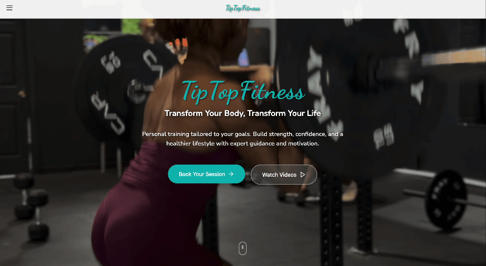
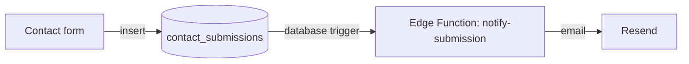

# TipTopFitness

**Live site:** https://tip-top-fitness-tau.vercel.app




A website for Tip, a personal trainer in Atlanta. Her clients needed one place to see services, follow exercise guides, and get in touch. I built it as a fast single-page app that she can share by link or QR code, with a contact form that stores every message and emails her.

## Pages

| Page | Route | Status | Notes |
|---|---|---|---|
| Home | `/` | Live | Fullscreen video hero |
| Guides | `/guides` | Live | Filter by station, deep links to sections |
| Guide detail | `/guides/:slug` | Live | QR code target, fullscreen video, coaching cues |
| Services | `/services` | Live | Group training open, 1-on-1 sold out |
| About | `/about` | Live | |
| Transformations | `/transformations` | Live | Client photos with duration badges |
| Contact | `/contact` | Live | Form stored in Supabase, emails Tip |

Two more routes exist but aren't linked from the nav yet.

## How the contact form works



1. `Contact.tsx` inserts a row into the `contact_submissions` table in Supabase.
2. A database trigger calls the `notify-submission` Edge Function on every insert.
3. The function formats the message and sends Tip an email through Resend.
4. Every submission stays in the database, so nothing is lost, even if the email fails.

The notification address and the Resend API key are Supabase secrets, not code. A GitHub Actions workflow redeploys the Edge Function whenever `main` changes.

## What I built

The project started as a Figma Make export: a routed shell with a generic UI kit and placeholder content. I turned it into the real site:

- Replaced placeholder content with Tip's real copy, pricing and photos.
- Built the Guides page from scratch: an exercise data model, a station filter, hash-anchor scrolling, and a `toAnchor()` helper so QR codes land on the right section.
- Added guide detail pages as QR code targets, with fullscreen video and coaching cues.
- Stripped audio from every guide video with `ffmpeg -an -c:v copy` instead of muting in JavaScript.
- Swapped the default fonts for Dancing Script (titles) and Nunito (body).
- Replaced the contact form's backend with Supabase and Resend (details above).
- Added Vercel Analytics and Speed Insights.
- Added Vitest and React Testing Library tests for the contact form, the Guides filter and the anchor helper.


## Decisions and trade-offs

- **Formspree to a direct Supabase insert.** Formspree was flagging legitimate messages as spam, and I had no way to look back at past submissions. Supabase stores every message. The cost is more to maintain: a table, a trigger and a function.
- **Exercise data is a hardcoded array.** Each exercise (slug, name, group, section, sets, reps, cues, `videoUrl`) lives in `Guides.tsx`. That got the site out the door. A self-hosted headless CMS (planned) is how Tip will eventually edit guides herself.
- **Videos live in the repo for now.** It's the simplest option at current traffic. At around 50 videos I'll move them to Cloudflare R2, which only means changing each `videoUrl`, since the components don't change.
- **SPA rewrite in `vercel.json`.** Every path is sent to `index.html`. Without it, a direct link to `/guides` or a QR code URL would 404.
- **QR code anchors through `toAnchor()`.** It lowercases and hyphenates section names so hash links match the section ids (`/guides#quads-glutes`). QR codes need to stay lowercase.

## Security

- The frontend only ships the public Supabase anon key. The notification address and Resend key are server-side secrets.
- Row Level Security is enabled on `contact_submissions`. The only policy is an INSERT policy, so anonymous visitors can submit the form but can't read, change or delete rows.
- The table, policy and trigger are configured in the Supabase dashboard, not in this repo.

I keep a checklist of things to re-verify in the dashboard in [docs/security-checklist.md](docs/security-checklist.md).

## Run locally

```bash
git clone https://github.com/Reggiezu/TipTopFitnessLandingPage.git
cd TipTopFitnessLandingPage
npm install
npm run dev
```

The contact form needs two variables in a `.env.local` file (your Supabase project URL and anon key; the names are in `src/vite-env.d.ts`). The file is gitignored.

## Run the tests

```bash
npm test            # run once
npm run test:watch  # re-run on change
```

The tests use Vitest and React Testing Library, with the Supabase client mocked, so they need no network or credentials.

## Roadmap

1. A self-hosted headless CMS (planned) so Tip can edit guides and photos without touching code.
2. Move guide videos to object storage (Cloudflare R2) once the library grows.
3. A dashboard view of contact submissions.

## Tech

Vite, React 18, Tailwind CSS 4, React Router 7, Supabase (Postgres and Edge Functions), Resend, Vercel, Vitest.